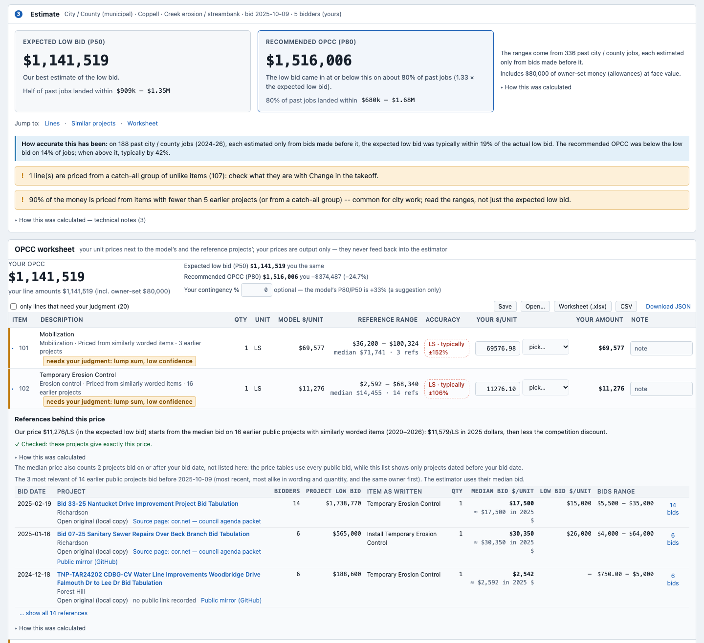

# Texas Public Works OPCC Estimator

A working aid for estimators preparing an opinion of probable construction cost (OPCC) for Texas public-works projects. For any bid schedule (a list of items with quantities) it does two things:

- **It puts the evidence in front of the estimator.** For every line it shows the earlier public bids behind the price: project, date, quantity, the low and median bidders' unit prices. Each project links to its full bid tabulation and to the public page it came from. It also shows the most similar past projects, the lines it cannot price (specialty items that need a vendor quote), and the lines whose prices are uncertain.
- **It estimates the bid where the history supports it:**
  - **P50**, the expected low bid;
  - **P80**, a "not-under" OPCC, set so that the actual low bid comes in below it on at least 80% of lettings.

The estimator stays in charge. The model's number is one input among the references, not a replacement for judgment. Where history is thin, the tool says so and leans on the references instead.

The focus is municipal work in the Dallas–Fort Worth area, especially creek erosion repair, drainage and streambank stabilization. Texas Department of Transportation (TxDOT) lettings are covered as a second market.

The model is trained **only on public bid tabulations**. Every number it reports was measured **forward in time**: each letting is priced using only lettings dated before it, the way the tool would actually be used.

> **Status: work in progress.** The data pipeline, the evaluation framework and two rounds of confirmed pricing changes are in place. TxDOT accuracy is near engineer level; municipal accuracy is still short of the goal (see below). This repository is being published step by step.

---

## Using it

**Try it online:** https://129-146-109-44.sslip.io (a demo on a free cloud server; files you upload are processed and not stored, so do not upload confidential documents).

Or start the app on your own machine with `.venv/bin/python ui/run.py`, then open http://127.0.0.1:8017/. Pricing is ready about 10 seconds after start.

1. **Enter the takeoff.**
   - Paste a bid schedule, or upload Excel, CSV, Word or PDF. Scanned PDFs are read with OCR.
   - Check each line's description, unit, quantity and the item type it was matched to. Change the type with the picker if it is wrong.
   - Lines the reader is unsure of are flagged, with the closest items from bid history to pick from. Corrections you make are remembered on your machine.
   - Lines it cannot read at all (stray symbols, garbled text, notes) are listed apart as "could not be read", with their original text; nothing is guessed from them. You can add any of them back.
   - Click "+ Add row" under the table to add a line. Drag a row by any part that is not an input box to move it; the other rows slide aside and it drops in where you let go.
2. **Describe the project.**
   - Market (city/county or TxDOT), owner, work type and bid date. If the owner or work type is not in the list, type it in.
   - Expected number of bidders: it is prefilled from similar past lettings, and you can change it.
   - The amounts of owner-set allowances; these are added at face value.
   - Vendor quotes for specialty items the tool does not price (pumps, generators, prefabricated bridges, …).
3. **Read the estimate.**
   - P50 (expected low bid) and P80 (a not-under OPCC), with their ranges and the market's track record.
   - The items left out for a vendor quote, and the lump sums whose prices are uncertain.
4. **Check the evidence.**
   - Click any line to see the earlier public bids behind its price: project, date, quantity, low and median bidders' unit prices.
   - Open a project to see its whole bid tabulation, the original document, its public source page, and its copy in the data repository.
   - The four most similar past projects are shown with their full bids.
5. **Build your OPCC.**
   - In the worksheet, keep the model's unit price or pick one from the references, line by line. Add notes and a contingency.
   - "Your OPCC" is shown next to the model's P50 and P80.
6. **Export** the worksheet to Excel or CSV, with your prices, notes and a references appendix.



*The estimate for a public creek-bank schedule (Coppell, 2025). P50 and P80 come with their ranges; one line is opened to the three most relevant earlier public bids, each linked to its source page and the public mirror.*


*The OPCC worksheet. Your own unit prices, notes and a contingency sit next to P50 and P80. Below it, the most similar past project is opened to its full public bid, with the lines that match yours highlighted.*

**Your inputs stay yours.**
- An engineer's estimate is never an input.
- Your prices never feed back into the model.
- Run locally, nothing leaves your machine. The one exception is the optional "Read with Claude" for difficult PDFs, which asks before sending each document.

## The goal

The estimate is meant to be used as an OPCC, where underestimating is the costly mistake. The target is:

1. **Floor:** the P80 estimate is below the actual low bid on **at most 20%** of lettings.
2. **Score:** within that floor, P80 should overshoot the low bid **as little as possible** (13% is the aspiration).
3. **Yardstick:** at the same not-under rate, the overshoot is compared with engineers' own estimates. Engineer estimates are never an input.

## Where it stands (2026-11-20)

All figures are forward in time: each letting is priced from lettings dated before it, and the model had not seen the letting.

| | Lettings | P50 median error | P80 under the low bid | Median overshoot (P80 ≥ low) | Overshoot at 70% / 75% / 80% not-under |
|---|---|---|---|---|---|
| **TxDOT** (DFW counties), 2023–26 | 807 | **16%** | 16% | 32% | **26% / 27% / 30%** |
| TxDOT engineers' own estimates (same 451 lettings, official totals) | 451 | 21% | 14% | — | 19% / 22% / 23% |
| **City / municipal** (DFW), 2024–26 | 224 | **21%** | 14% | 46% | **31% / 32% / 36%** |
| Municipal engineers' own estimates | 140 | ~15% | 33% | — | 20% / 21% / 25% |
| Locked public test set, municipal (last confirmation) | 56 | 14% | 20% | 31% | — |

Municipal figures use the "covered" scope (see below). The discount uses each letting's actual number of bidders, which is not known when quoting. On the previous data build, a forecast bidder count from earlier lettings of the same market, work type and size cost TxDOT about 2 points of overshoot and left municipal unchanged. Figures are from the current data build: parser .32 (2026-11-21), plus 58 more public bid tabs from smaller DFW cities and counties, many found inside city council agenda packets. Parser rounds 10 and 11 made three changes:
- they read more table layouts;
- they tell an engineer's column from a bidder's;
- they recover units printed in odd places, about 8,500 lines.

Many of the newly scorable jobs are hard to estimate, with specialty items the model prices low. Since the parser .29 build:
- overshoot rose from 42% to 46%;
- the overshoot at a matched 80% not-under rate rose from 32% to 36%;
- the median P50 error rose from 19% to 21%.

On the lettings that both builds score, the change is within noise. That build corrected misread bid dates and labels, priced a few more item wordings correctly, and stopped scoring annual / as-needed unit-price contracts as projects: their bid totals are an evaluation formula over notional quantities, not the price of a project. Their unit prices stay in the price history. The locked-set row is from the last confirmation, before the latest data fixes and the scope change. For the engineer rows, "P80 under the low bid" means their single published estimate came in under the low bid.

## Strengths and limitations

**Strengths**

- **TxDOT is close to engineer level.**
  - On 806 DFW TxDOT lettings, the median P50 error is 16%.
  - On the 451 of them with an official engineer's estimate, our median error (17%) is lower than the engineers' (21%), whose estimates run about 20% high.
  - At an 80% not-under rate, the engineers still overshoot less: 23% vs our 31%.
- **Standard items are priced close to the bidders' own spread.** On TxDOT, half of the asphalt, bridge concrete, concrete pavement, riprap, headwall, box culvert and storm pipe lines are within 14–20% of the median bid. In cities, the same holds for curb ramps, driveways and inlets (17–23%). See [Item-level accuracy](#item-level-accuracy).
- **The evaluation is strict.**
  - Every figure is forward in time.
  - Decisions are registered before they are scored.
  - A locked public test set is opened only to confirm a registered decision, and each opening is logged.
  - Leak guards stop any build in which test data reaches a fitted number.
- **Public data only.** Engineer estimates are a yardstick, never an input.
- **Every number can be traced.** The local web UI (`ui/`) prices a schedule with the same estimator. It shows the reference projects behind each line price, the four most similar past projects, and which lines are not covered or low confidence.
- **It says what it does not know.** Specialty items with almost no bid history are marked "not covered" and listed for separate (vendor) pricing instead of being guessed. Examples: pumps and pump/lift-station equipment, generators and electrical gear, prefabricated or pedestrian bridges, tanks and process equipment.

**Limitations**

- **City (municipal) estimates are less accurate.**
  - The median P50 error is 21%, against about 15% for the engineers.
  - At an 80% not-under rate the overshoot is about 36%, against the engineers' 25%.
  - Almost all of this error comes from estimating the bidders' typical (median) price for the schedule. Very little comes from the step from the median bid to the low bid.
- **Lump-sum items do not yet scale with job size.**
  - Mobilization, traffic control, site preparation and SWPPP / erosion-control lump sums are priced at about the same dollar amount on every job. Bidders price them as a share of the job (mobilization is typically about 5%).
  - Small city jobs (low bid under $0.5M, 74 lettings) come out about 19% high (P50 error 24%).
  - Jobs over $2M come out about 4% low, and P80 is under the low bid on 25% of them.
  - Pricing them as a share of the job fixes the lump-sum lines themselves, but it did not make job totals more accurate (round 12, under "Tried and not adopted").
- **Creek erosion and drainage** (42 lettings) is better than the city average: P50 error 18%, P80 under the low bid 2% of the time, median overshoot 41%. The recovered units brought in more recent creek and drainage prices. They raised this group's estimates by about 4%, so it now errs on the high side. Part of the drop in under-estimates (from 10%) is a relabelling, not better pricing: a lift station and an artificial-turf field that had been labelled drainage left this group.
- **Recent lettings run higher than history.** In 2026, P80 was under the low bid on 17% of municipal and 23% of TxDOT lettings; TxDOT is above the 20% floor. The guard adapts, but with a lag.
- **About a third of the worst municipal misses cannot be fixed this way.** They are ordinary market variation between bidders that bid history alone cannot predict. Another sixth are one-off specialty items, which are now marked not covered.
- **City data is thin.** Many city items have little bid history. Some cities publish bid tabs only behind vendor portals, which are not collected. Scanned tabs lose lines.
- **Not runnable end to end from this repository.** A few pipeline modules still carry client-specific configuration and are not published. The bid-tab corpus (several GB) is not distributed.

**Tried and not adopted (yet).** Pricing municipal lines from municipal-only price data, instead of data dominated by TxDOT price levels, together with four smaller pricing fixes.
- **Forward tests:** passed the registered test. Municipal overshoot fell 49% → 42% and P50 error 24% → 20%.
- **Locked test set:** failed. Its tighter P80 margin let P80 fall under the low bid on 29% of lettings, against 19% for the current rule.
- **Status:** kept in the code, switched off. It will be re-checked on new lettings.

**Lump sums as a share of the job (round 12, registered before scoring).** Mobilization, traffic control, site preparation, SWPPP and bonds were priced as a share of the rest of the job. The shares were learned from earlier bids, by job size. A size-dependent centring of P50 was tested alone and together with it.
- **The lump-sum lines themselves became much more accurate.**
  - Against the median bidder, the typical miss fell from about 2.3× to 1.7×.
  - On small jobs our lump sums went from 2.8× the bidders' amounts to 0.9×; on large jobs from 0.56× to 0.97×.
- **Size-dependent centring removed the size bias of P50.** The median P50 ÷ low bid on small / medium / large jobs went from 1.26 / 1.07 / 0.94 to 1.10 / 1.05 / 1.00.
- **The spread of job-total errors did not shrink** (mean |ln| 0.331 either way). So the P80 margin needed to stay at or above the low bid 80% of the time stayed as wide.
  - No variant lowered the median overshoot by the registered margin.
  - The lump-sum variants pushed the 2026 under-rate just over its limit, by one letting.
  - On small jobs, lowering the lump sums exposed unit-priced lines that run low. On large jobs, most of the misses were too large for a few percent to rescue.
- **Status:** not adopted; production is unchanged. The code is kept in a development copy, switched off.

**Waiting for new lettings (round 13, registered before scoring).** Municipal lines priced from cells dominated by TxDOT lettings were moved to the municipal price level.
- **Development result:** the median overshoot fell from 43% to 38%, mostly because the P80 margin got tighter.
- **Status:** as registered, it stays switched off until 40 new municipal lettings after 2026-11-20 confirm it (`data/test_holdout/REGISTRATIONS.md`, section 6).
- **A second change** shrank prices backed by a single earlier letting. It fixed the worst single lines (a 48-inch water line went from 3.7× to 0.8× the bids), but it did not make job totals more accurate.

**Line fixes that did not narrow the margin (round 14, registered before scoring).** Three general fixes were tried, alone and together:
- a mobilization line that prints a cap ("5% Max") priced at that cap times the rest of the job;
- weakly matched item-word prices blended with the price for that kind of item at its size;
- round 13's shrinkage of prices backed by a single earlier letting.

What happened:
- **The lines became clearly more accurate.**
  - Over 8,766 city lines, the total miss against the median bidder fell from $299M to $266M with all three.
  - Capped mobilization lines went from 2.0× to 1.0× the bids.
- **Job totals did not.** No variant lowered the median overshoot by the registered margin.
- **None passed the line-accuracy route either.**
  - That route was registered this round, because the worksheet shows our line prices. It also requires that the median overshoot not rise by more than 1 point at the upper end of its 90% interval.
  - The variants reached +1.9 to +2.9 points.
- **Why the totals did not move.**
  - On small jobs, correcting the overpriced mobilization exposed unit-priced lines that run low.
  - On large jobs, the misses come from weakly matched main items, not from mobilization.
- **Status:** not adopted; production is unchanged.

**Converting between units (registered before scoring).** Takeoffs come in mixed units: CY or CF, SY or SF or acres, tons or pounds. Two ways of converting between units of the same kind were tested.
- **Pooling all bids into one unit per kind** makes a takeoff price the same in any unit, to the cent.
  - Today, rewriting the units of 188 city takeoffs changes P50 by more than 20% on 79 of them, and leaves 624 lines unpriced.
  - It was still not adopted, because line accuracy got worse. A rarer unit often marks a different product: seeding by the acre costs about a quarter of sod by the square yard, and sidewalk bid by the square foot runs 1.5 times the square-yard price. Converting thousand-gallon watering into gallons also pushed every quantity into the top quantity class.
- **Converting only lines whose own unit has fewer than 5 earlier lettings** cut the unpriced lines from 624 to 42. The few converted lines were often different products or misclassified, so it did not pass either.
- **Leaving such lines unpriced** was tested too: a line resting on fewer than 5 earlier lettings in a unit that is rare for its item type, when the usual unit has 5 or more. It touched only 15 city lettings and narrowly failed the registered test.
- **Status:** none of the three is used for P50/P80. The worksheet shows a converted reference price as a hint, for the estimator to accept or not. For example: "only 1 earlier letting prices this in CF; 622 price it in CY: about $0.78/CF".

## Item-level accuracy

How close the price of each kind of line item is, before the lines are added up. Job totals are more accurate than single lines, because line errors partly cancel.

**How it is measured**
- Every line of every scored letting is priced forward in time: from earlier lettings only.
- The comparison uses the line price itself, before the comparables blend and the competition discount.
- It is compared with the **median bidder's** amount on the same line, on lines with at least 3 bidders. Owner-set and not-covered lines are left out.

**Columns**
- "Half of lines within": half of the lines are closer to the median bid than this.
- "Ours ÷ median bid": the typical ratio. Above 1 means we run high.
- "Low bidder vs median bidder": how far the low bidder usually is from the median bidder on the same line. That is the spread between bidders themselves, which no estimate can remove.

**What it shows**
- **Standard concrete, drainage and paving items are already close to the bidders' own spread.** Examples: curb ramps, driveways, inlets, sidewalk, concrete pavement, storm pipe and box culverts in cities; riprap, headwalls, box culverts, storm pipe and concrete pavement on TxDOT.
- **Lump sums and other general-condition items are the weakest in both markets.**
  - In cities, mobilization, traffic control, site preparation and SWPPP lump sums are priced at about the same dollar amount on every job, while bidders price them as a share of the job. A share-of-job rule makes these lines much closer to the bids (round 12) but did not improve job totals, so it is not in use yet.
  - On TxDOT, mobilization is already priced as a share of the job.
- **Many items are 8–9 points more accurate on TxDOT than in cities:** sidewalk, concrete pavement, storm pipe and box culverts.
  - TxDOT's standard item codes keep descriptions uniform and history deep. City wording varies, and city data is thinner.
  - Curb ramps, driveways and inlets are about as accurate in cities as on TxDOT.
- **The city items with the most money still to gain:**
  - water pipe (8% of city dollars, half within 46%);
  - mobilization (5%, runs 48% high);
  - asphalt (4%, half within 36%);
  - unclassified lines (4%, half within 109%).
  - Fire hydrants run 31% low, pavement marking 21% low, and miscellaneous concrete 12% high.

#### City / municipal (DFW), 2024–26: 224 lettings, 9,991 lines

Across all lines, half are within **46%** of the median bid (**41%** weighted by dollars); 28% are within ±20%. The low bidder is typically 24% from the median bidder on the same line.

| Item | Lines | Lettings | Share of dollars | Half of lines within | Dollar-weighted | Ours ÷ median bid | Lines within ±20% | Low bidder vs median bidder |
|---|---|---|---|---|---|---|---|---|
| ADA curb ramps | 201 | 92 | 0.8% | 17% | 16% | 0.97 | 54% | 22% |
| Driveways | 126 | 83 | 1.5% | 19% | 15% | 0.97 | 52% | 21% |
| Inlets | 271 | 67 | 1.6% | 23% | 24% | 1.00 | 47% | 17% |
| Project signs | 77 | 71 | 0.0% | 25% | 41% | 1.04 | 40% | 29% |
| Sidewalk | 229 | 127 | 3.7% | 25% | 22% | 1.06 | 43% | 23% |
| Valves and hydrants | 184 | 79 | 1.9% | 26% | 47% | 0.88 | 42% | 15% |
| Concrete pavement | 198 | 103 | 12.4% | 27% | 20% | 0.99 | 39% | 13% |
| Signs | 82 | 51 | 0.1% | 27% | 11% | 1.00 | 40% | 20% |
| Water services | 134 | 55 | 2.1% | 28% | 15% | 0.86 | 43% | 19% |
| Box culverts | 67 | 31 | 1.5% | 28% | 22% | 0.94 | 40% | 16% |
| Storm pipe | 321 | 81 | 3.0% | 28% | 23% | 0.91 | 37% | 19% |
| Flexible base | 112 | 85 | 2.5% | 32% | 45% | 0.92 | 33% | 26% |
| Embankment / fill | 62 | 51 | 0.7% | 32% | 49% | 1.13 | 31% | 55% |
| Drilled shafts | 57 | 28 | 1.6% | 33% | 38% | 0.80 | 30% | 15% |
| Stone riprap | 56 | 43 | 0.8% | 33% | 36% | 0.88 | 25% | 27% |
| Concrete beams | 47 | 31 | 0.5% | 34% | 53% | 0.91 | 26% | 40% |
| Asphalt pavement | 180 | 88 | 4.4% | 36% | 29% | 0.99 | 31% | 19% |
| Subgrade stabilization | 136 | 64 | 2.7% | 37% | 40% | 0.81 | 29% | 19% |
| Traffic signals | 250 | 24 | 0.7% | 37% | 53% | 0.99 | 41% | 12% |
| Excavation | 143 | 105 | 2.7% | 37% | 33% | 0.94 | 28% | 35% |
| Tree removal | 68 | 45 | 0.1% | 39% | 62% | 0.97 | 22% | 33% |
| Pavement removal | 155 | 94 | 1.6% | 39% | 47% | 0.88 | 26% | 30% |
| Seeding and sod | 353 | 178 | 1.9% | 39% | 56% | 0.91 | 33% | 23% |
| Testing and inspection | 71 | 42 | 0.3% | 41% | >1000% | 1.02 | 27% | 32% |
| Electrical and lighting | 427 | 46 | 2.0% | 42% | 65% | 0.85 | 29% | 13% |
| Erosion control (unit-priced) | 177 | 76 | 0.4% | 45% | 84% | 0.81 | 27% | 33% |
| Fire hydrants | 64 | 58 | 0.5% | 46% | 38% | 0.69 | 28% | 17% |
| Water pipe | 284 | 71 | 7.7% | 46% | 40% | 0.95 | 27% | 27% |
| Sidewalk removal | 111 | 64 | 0.2% | 46% | 34% | 1.04 | 25% | 31% |
| Miscellaneous concrete | 142 | 80 | 1.1% | 46% | 39% | 1.12 | 19% | 27% |
| Curb and gutter | 136 | 90 | 0.7% | 47% | 39% | 1.12 | 29% | 35% |
| Casing / encasement | 160 | 73 | 2.8% | 47% | 161% | 0.90 | 27% | 25% |
| Adjust to grade | 173 | 77 | 0.2% | 48% | 48% | 0.99 | 28% | 43% |
| Manholes | 175 | 69 | 2.0% | 48% | 71% | 0.93 | 29% | 21% |
| Sanitary sewer pipe | 131 | 49 | 2.8% | 49% | 51% | 1.00 | 23% | 42% |
| Utility removal / abandonment | 298 | 99 | 0.6% | 50% | 44% | 0.95 | 24% | 44% |
| Traffic control (unit-priced) | 78 | 56 | 0.6% | 53% | 53% | 1.31 | 21% | 27% |
| Guardrail | 60 | 26 | 0.1% | 54% | 59% | 0.70 | 27% | 22% |
| Contingency / allowance lines | 78 | 23 | 0.5% | 56% | 102% | 0.94 | 28% | 21% |
| Other removals | 170 | 85 | 0.5% | 56% | 66% | 0.95 | 25% | 40% |
| Sewer services | 51 | 31 | 0.3% | 57% | 61% | 1.24 | 22% | 36% |
| Pavement marking | 608 | 88 | 0.4% | 58% | 91% | 0.79 | 20% | 21% |
| Pipe fittings | 59 | 36 | 0.3% | 62% | 49% | 1.27 | 24% | 33% |
| Retaining walls | 55 | 32 | 1.6% | 62% | 88% | 1.00 | 20% | 30% |
| Relocate / reset | 186 | 79 | 0.2% | 63% | 105% | 0.88 | 22% | 41% |
| Tree planting | 68 | 46 | 0.2% | 66% | 222% | 0.95 | 29% | 14% |
| Trench safety | 120 | 81 | 0.2% | 69% | 94% | 0.89 | 20% | 67% |
| Structure demolition | 90 | 54 | 0.1% | 72% | 244% | 0.88 | 16% | 33% |
| Fence | 101 | 64 | 0.4% | 72% | 177% | 0.86 | 20% | 27% |
| Headwalls | 58 | 40 | 0.4% | 80% | 434% | 0.73 | 9% | 48% |
| Landscape planting | 103 | 23 | 0.2% | 100% | 94% | 1.61 | 17% | 11% |
| SWPPP / temporary erosion control (lump sum) | 164 | 152 | 0.3% | 102% | 161% | 1.06 | 12% | 49% |
| Unclassified lines | 781 | 160 | 3.7% | 109% | 280% | 0.95 | 16% | 29% |
| Traffic control (lump sum) | 146 | 137 | 0.9% | 119% | 292% | 1.45 | 9% | 59% |
| Site preparation (lump sum) | 81 | 76 | 1.4% | 123% | 388% | 0.97 | 20% | 82% |
| Irrigation | 74 | 43 | 0.6% | 136% | 153% | 1.14 | 4% | 18% |
| Mobilization | 196 | 194 | 4.7% | 150% | 379% | 1.48 | 10% | 34% |

#### TxDOT (DFW counties), 2023–26: 807 lettings, 41,159 lines

Across all lines, half are within **31%** of the median bid (**26%** weighted by dollars); 37% are within ±20%. The low bidder is typically 16% from the median bidder on the same line.

| Item | Lines | Lettings | Share of dollars | Half of lines within | Dollar-weighted | Ours ÷ median bid | Lines within ±20% | Low bidder vs median bidder |
|---|---|---|---|---|---|---|---|---|
| Construction exits | 173 | 172 | 0.1% | 13% | 17% | 0.99 | 65% | 17% |
| Asphalt pavement | 651 | 282 | 11.5% | 14% | 12% | 0.93 | 62% | 9% |
| Bridge concrete | 426 | 75 | 5.1% | 14% | 11% | 0.93 | 62% | 15% |
| Concrete mow strip | 189 | 183 | 0.5% | 15% | 16% | 1.06 | 64% | 11% |
| Sidewalk | 161 | 114 | 0.6% | 16% | 9% | 0.97 | 60% | 12% |
| Construction exit removal | 170 | 170 | 0.0% | 16% | 15% | 1.06 | 58% | 17% |
| Headwalls | 218 | 78 | 0.1% | 17% | 15% | 0.99 | 57% | 9% |
| Concrete riprap | 252 | 192 | 0.5% | 17% | 10% | 1.02 | 57% | 15% |
| Stone riprap | 277 | 197 | 0.9% | 18% | 19% | 0.94 | 55% | 14% |
| Flowable backfill | 192 | 161 | 0.3% | 19% | 21% | 0.92 | 53% | 17% |
| Concrete pavement | 132 | 83 | 8.1% | 19% | 8% | 0.93 | 52% | 12% |
| Box culverts | 362 | 98 | 2.1% | 19% | 20% | 0.94 | 51% | 15% |
| Concrete beams | 64 | 55 | 0.1% | 19% | 19% | 0.95 | 55% | 25% |
| Storm pipe | 634 | 150 | 1.9% | 19% | 16% | 1.01 | 52% | 14% |
| Casing / encasement | 316 | 127 | 0.6% | 19% | 49% | 0.92 | 52% | 12% |
| Bridge railing | 267 | 129 | 1.1% | 20% | 24% | 0.95 | 51% | 15% |
| Lighting assemblies | 160 | 56 | 0.3% | 20% | 36% | 0.86 | 49% | 6% |
| Traffic signals | 2257 | 116 | 1.5% | 20% | 28% | 0.89 | 49% | 10% |
| Inlets | 543 | 75 | 1.1% | 21% | 25% | 0.86 | 48% | 16% |
| Signs | 1392 | 262 | 0.7% | 21% | 27% | 1.04 | 48% | 9% |
| Drilled shafts | 574 | 166 | 3.6% | 22% | 32% | 0.86 | 45% | 13% |
| Driveways | 224 | 137 | 0.7% | 22% | 21% | 0.95 | 44% | 13% |
| ADA curb ramps | 397 | 102 | 0.2% | 22% | 22% | 0.91 | 47% | 13% |
| Flexible base | 127 | 109 | 1.4% | 23% | 17% | 0.91 | 46% | 11% |
| Erosion control (unit-priced) | 1717 | 412 | 0.3% | 24% | 20% | 0.97 | 44% | 20% |
| Wingwalls | 293 | 94 | 0.3% | 24% | 23% | 0.95 | 41% | 14% |
| Borrow / backfill | 141 | 136 | 0.1% | 24% | 21% | 1.05 | 44% | 25% |
| Pavement milling | 236 | 196 | 0.9% | 24% | 21% | 0.98 | 43% | 15% |
| Electrical and lighting | 2109 | 142 | 1.1% | 25% | 42% | 0.85 | 41% | 12% |
| Safety end treatments | 516 | 125 | 0.2% | 25% | 23% | 0.92 | 42% | 17% |
| Retaining walls | 65 | 51 | 2.6% | 26% | 23% | 0.89 | 35% | 23% |
| Subgrade stabilization | 353 | 139 | 2.3% | 29% | 27% | 0.85 | 32% | 11% |
| Concrete joints | 267 | 151 | 0.4% | 29% | 40% | 0.88 | 40% | 21% |
| Concrete barrier | 855 | 181 | 2.0% | 30% | 24% | 1.01 | 36% | 25% |
| Guardrail | 1690 | 289 | 0.8% | 30% | 24% | 1.22 | 33% | 11% |
| Curb and gutter | 288 | 160 | 0.3% | 33% | 30% | 0.91 | 35% | 22% |
| Shoring | 113 | 109 | 1.3% | 34% | 48% | 0.94 | 31% | 27% |
| Surface treatment | 360 | 261 | 0.2% | 34% | 33% | 1.08 | 33% | 29% |
| Embankment / fill | 291 | 229 | 3.0% | 35% | 35% | 1.04 | 31% | 29% |
| Concrete repair | 304 | 128 | 0.7% | 35% | 34% | 1.16 | 30% | 27% |
| Pavement marking | 8266 | 423 | 1.6% | 36% | 26% | 1.13 | 32% | 12% |
| Testing and inspection | 98 | 44 | 0.0% | 37% | 17% | 1.11 | 36% | 19% |
| Pavement removal | 433 | 218 | 0.8% | 38% | 38% | 0.89 | 27% | 20% |
| Seeding and sod | 1052 | 299 | 0.8% | 38% | 23% | 1.02 | 30% | 32% |
| Miscellaneous concrete | 238 | 141 | 0.8% | 38% | 45% | 0.85 | 28% | 25% |
| Other removals | 674 | 277 | 0.7% | 40% | 27% | 0.97 | 30% | 26% |
| Mowing | 451 | 193 | 0.8% | 41% | 21% | 1.22 | 29% | 23% |
| Excavation | 348 | 223 | 1.8% | 42% | 66% | 0.97 | 28% | 32% |
| Fence | 277 | 122 | 0.3% | 43% | 49% | 1.04 | 31% | 25% |
| Utility removal / abandonment | 621 | 188 | 0.9% | 43% | 271% | 0.91 | 29% | 41% |
| Unclassified lines | 3758 | 551 | 10.1% | 44% | 31% | 1.00 | 28% | 17% |
| Sidewalk removal | 252 | 151 | 0.1% | 47% | 57% | 0.96 | 24% | 22% |
| Mobilization | 913 | 806 | 9.8% | 51% | 40% | 1.07 | 28% | 25% |
| Adjust to grade | 89 | 56 | 0.0% | 53% | 114% | 0.91 | 25% | 43% |
| Relocate / reset | 118 | 70 | 0.0% | 54% | 489% | 0.91 | 30% | 28% |
| Manholes | 67 | 26 | 0.1% | 55% | 209% | 0.70 | 30% | 21% |
| Crash cushions | 500 | 124 | 0.5% | 55% | 58% | 1.32 | 19% | 27% |
| Tree removal | 253 | 59 | 0.1% | 57% | 49% | 1.33 | 22% | 60% |
| Cleaning / desilting | 150 | 104 | 0.2% | 59% | 58% | 0.81 | 22% | 28% |
| Traffic control (per month) | 2211 | 784 | 3.9% | 65% | 241% | 1.24 | 23% | 63% |
| Structure demolition | 119 | 73 | 0.1% | 65% | 531% | 0.81 | 23% | 38% |
| Preparing right of way / clearing | 242 | 228 | 5.8% | 160% | >1000% | 1.24 | 9% | 71% |

## How it works

```
public bid tabs (PDF / XLSX / scans)
      │  harvest: city and county bid archives, council agenda packets, TxDOT open data
      ▼
parse  ── text layer, coordinate reader, OCR (best of 4 engines), arithmetic checks
      ▼
panel  ── one row per bidder × line item; item family, unit, size, quantity band
      ▼
reference prices ── two-stage medians (within letting, then across lettings),
                    price index by market, competition discount by bidder count
      ▼
estimate(schedule) ── price each line, sum; blend with the five most similar
                       earlier jobs (comparables); competition discount  →  P50
      ▼
forward calibration ── centring and the P80 divisor from earlier lettings only,
                       plus an adaptive guard aimed at a 16% under-share  →  P80
```

## Rules the project holds itself to

- **Public data only.** No client or company files are in this repository, and none are ever used to train or tune the model.
- **Engineer estimates are a yardstick, never an input.** They are not used as a feature or a target.
- **Forward in time.** Every reported accuracy figure prices each letting using only earlier lettings.
- **Locked public test set.** 71 public files (22% of each year × work-type stratum) never train anything. The set is opened only to confirm a decision registered in advance, and every opening is logged in `data/test_holdout/`.
- **Guards.** `src/provenance_check.py` and `src/train_test_guard.py` recompute fitted tables with test rows switched on and off. A build fails if any test data reaches a fitted number.
- **Pre-registration.** Pricing changes are written down with their pass/fail rule before they are scored.

## Repository layout

| Path | What it is |
|---|---|
| `src/` | Pipeline: harvesting, parsing, OCR, panel build, reference tables, estimator, evaluation and guards |
| `ui/` | A small local web app for pricing a schedule |
| `data/test_holdout/` | Registry and access log of the locked public test set (file list only) |

Not included:

- **The derived tables:** several GB built from the bid tabs. The original documents themselves are in the companion data repository below.
- **Experiment reports and setup notes:** kept in the working copy; the results that matter are summarized in this README.
- **The original bid documents** are published separately: https://github.com/grintCactus/texas-public-works-bid-tabs (2,150 public bid tabulations and award documents, with each file's source page).
- **Local tools:** poppler, Tesseract and the Python environment.
- **Some pipeline modules:** they still carry client-specific configuration, which is being moved out into a local file. They will be added in a following commit.

## Running it

Requires Python 3.12 on macOS or Linux.

```bash
python3 -m venv .venv
.venv/bin/python -m pip install -r requirements.txt
```

Text extraction and OCR use poppler (`pdftotext`) and Tesseract, installed from conda-forge into `tools/` (see `tools/README.txt` in a working copy). A full rebuild (`bash src/rebuild_all.sh`) needs the bid-tab corpus, which is not distributed here.

The web UI: `.venv/bin/python ui/run.py` opens http://127.0.0.1:8017/. It needs the built tables in `data/clean`; see `ui/README.md`.

## License

No license has been chosen yet; all rights reserved by the author.
